<p align="center">
  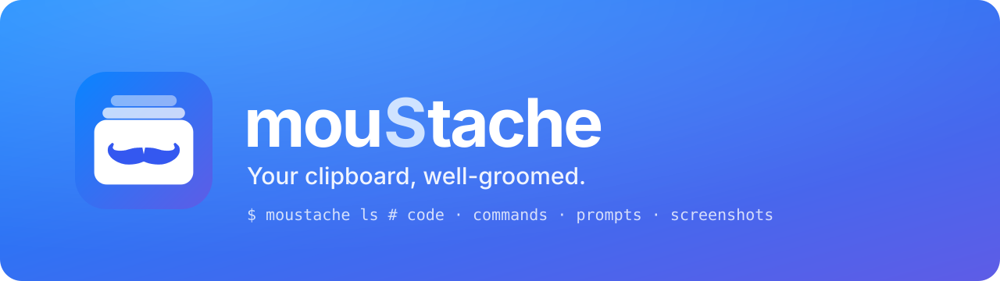
</p>

<p align="center">
  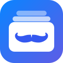
</p>

<h1 align="center">mouStache</h1>

<p align="center">
  <b>A clipboard manager for IT students, built as a Chrome / Edge side panel.</b><br>
  It saves what you copy, tags it automatically, previews code properly, and puts it back with one shortcut.
</p>

<p align="center">
  
  
  
  
</p>

<p align="center">
  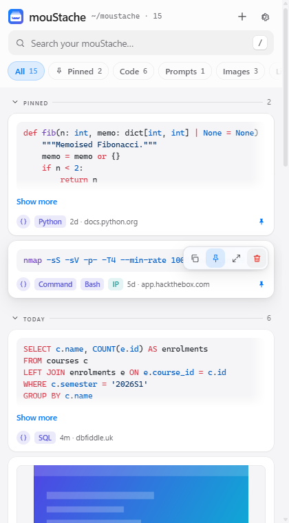
  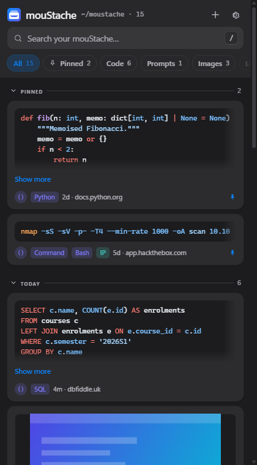
  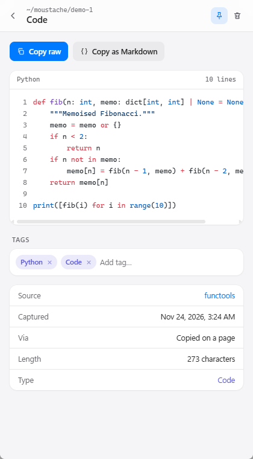
</p>

---

## Contents

- [Why mouStache](#why-moustache)
- [What it does](#what-it-does)
- [Smart auto-tagging](#smart-auto-tagging)
- [The quick palette](#the-quick-palette)
- [Built for long sessions](#built-for-long-sessions)
- [Privacy and safety](#privacy-and-safety)
- [Shortcuts](#shortcuts)
- [Install](#install)
- [Develop and test](#develop-and-test)
- [How it works](#how-it-works)
- [Brand](#brand)
- [Desktop app](#desktop-app)

## Why mouStache

Studying IT means copying all day: a `docker run` line, a subnet, a stack trace, a SQL query, a prompt you spent ten minutes on. The system clipboard remembers exactly one thing, and your browser history forgets the rest. mouStache keeps it, sorts it, and makes it easy to find again.

- **Hard to forget.** It lives in the browser side panel, shows a toolbar badge for new captures, and opens a Spotlight-style palette from anywhere with `Alt+Shift+V`.
- **Understands IT content.** It knows a Cisco command from a CIDR block from a Python function, and tags each one.
- **Quiet and private.** Everything stays on your device. Secrets and password-manager pages are skipped by default.

## What it does

| Capture | How |
| --- | --- |
| **Copies on web pages** | Select text and press `Ctrl/Cmd+C`. Sites' own "Copy" buttons (GitHub, docs, ChatGPT-style code blocks) are caught too. |
| **Right-click** | Save a selection, image, link or page link from the context menu. |
| **Screenshots** | Capture the visible tab, or drag a region with `Alt+Shift+S`. |
| **Paste into the panel** | Paste text or an image (for example from `Win+Shift+S`). A "Paste from clipboard" button does the same. |

Then you can **search** (text, tags, languages, source sites), **filter** by type, **pin** what matters, **delete with undo**, edit tags, and **copy back** as raw text or as a fenced Markdown code block.

<p align="center">
  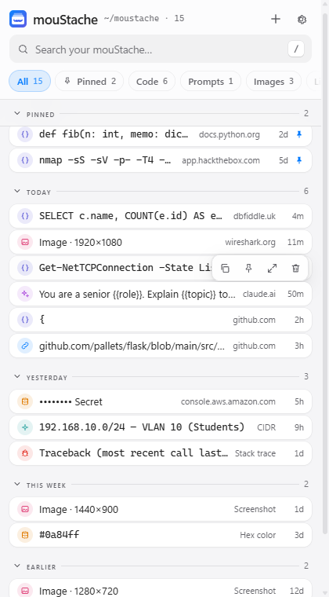
  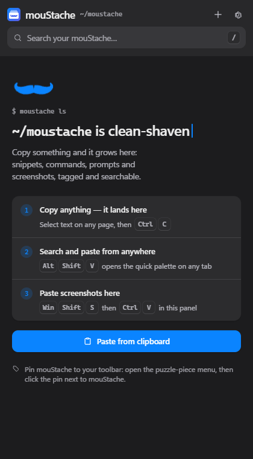
  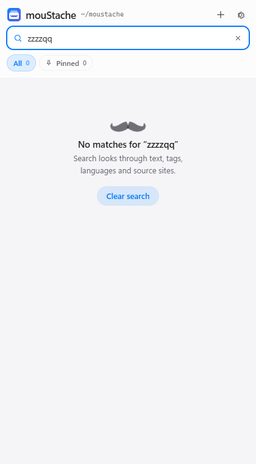
</p>

## Smart auto-tagging

Every capture is classified locally, with no network calls. Tags show as coloured chips and drive the filter bar.

| Group | Detected |
| --- | --- |
| **Code** | 15 languages (TypeScript, JavaScript, Python, Java, C#, C++, C, SQL, HTML, CSS, PowerShell, Bash, Go, Rust, PHP), shell commands, and JSON / YAML data |
| **Network** | IPv4 / IPv6, CIDR and subnet masks, MAC addresses, ports, Cisco IOS commands |
| **Errors** | Error messages and stack traces |
| **Prompts** | AI prompts (instructions such as "act as…", "you are…", "your task is…") |
| **Links** | URLs and email addresses |
| **Data** | Regex, hex colours, UUIDs, hashes, base64, Unix timestamps |
| **Secrets** | API keys, tokens and JWTs, flagged and blurred until you reveal them |

Code gets syntax highlighting (Shiki, loaded lazily per language), line numbers, "Copy raw" and "Copy as Markdown".

## The quick palette

Press `Alt+Shift+V` (`⌥⇧V` on Mac) on any page. Type to search, use the arrow keys, and press `Enter` to paste into the field you were in. It lives in a closed shadow root, so the page can't read your history.

<p align="center">
  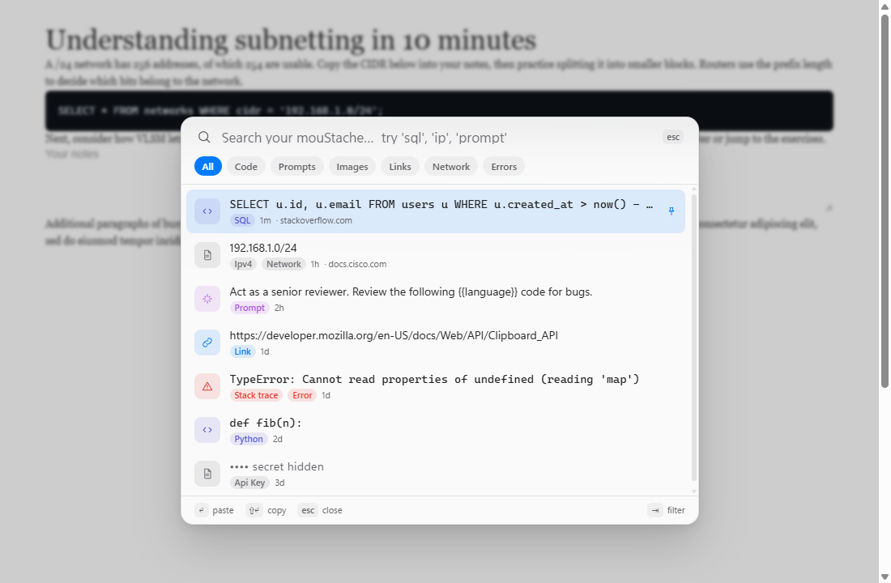
  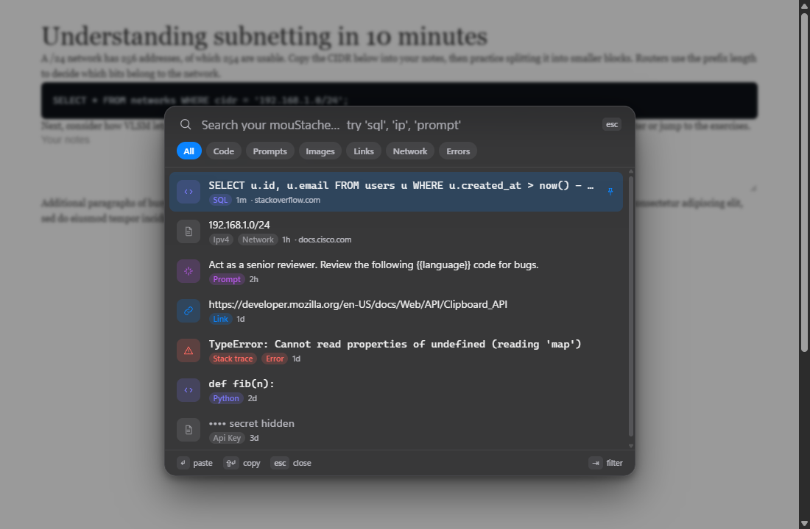
</p>

## Built for long sessions

Open **Settings > Comfort**. Everything applies live in the panel and on pages.

- **Theme** System / Light / Dark. **Text size** Small to Extra large. **Density** Comfortable cards or Compact rows.
- **Reduce motion** System / On / Off, and **Quiet mode** (no on-page toast, no badge count).
- A virtualised list that stays smooth with thousands of items. Sticky, collapsible date sections.
- The panel remembers your filter, search, scroll position and collapsed sections when you reopen it.
- Storage tools: auto-delete unpinned items older than 7 / 30 / 90 days (pinned items are never touched), "Clean up screenshots", and a live "N items, about X MB" line.

<p align="center">
  
  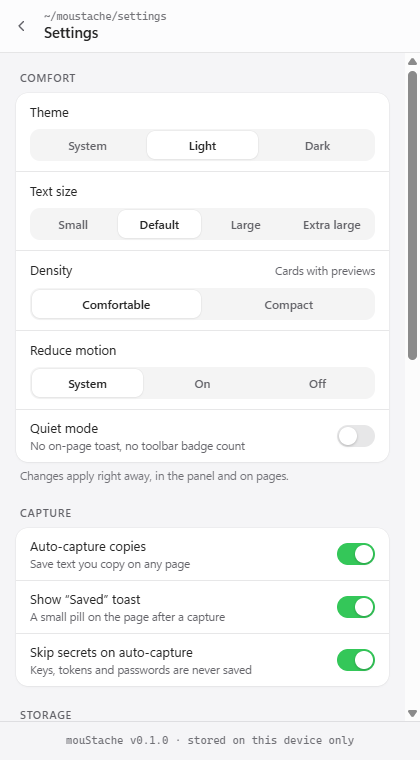
  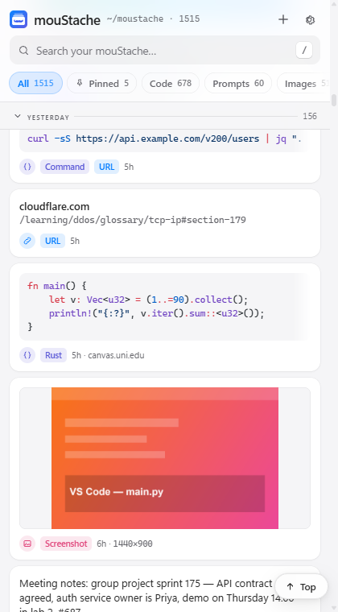
</p>

## Privacy and safety

- **Local only.** Items live in your browser's IndexedDB. Nothing is uploaded. Export and import as JSON from Settings.
- **Secrets are not auto-saved.** Copies that look like API keys, tokens or JWTs are skipped on automatic capture.
- **Password managers and sign-in pages are paused by default** (1Password, Bitwarden, LastPass, Dashlane, Proton Pass, Keeper, Google and Microsoft sign-in). You can edit the list in Settings.
- **Source URLs are trimmed** to the address without the query string or fragment.
- **Pages can't read your history.** The palette runs in a closed shadow root, and forged copy events from a page are ignored.
- **Abuse limits.** A page can add at most 10 items per 10 seconds, and untrusted events need a real user gesture.
- Exports are plain JSON. Treat an export file like any other file that contains your copied text.

## Shortcuts

| Windows / Linux | macOS | Action |
| --- | --- | --- |
| `Alt+Shift+V` | `⌥⇧V` | Open the quick palette |
| `Alt+Shift+S` | `⌥⇧S` | Screenshot a region to mouStache |

In the panel: `/` search (or just type), `J` / `K` move, `Enter` copy, `P` pin, `E` details, `Del` delete (4 s undo), `?` cheat sheet.

Hints adapt to your platform automatically, so macOS shows ⌘ ⌥ ⇧ instead of Ctrl, Alt and Shift. Change the shortcuts at `chrome://extensions/shortcuts`. Clicking the toolbar icon opens the side panel.

## Install

mouStache is not on the Chrome Web Store yet, so load it unpacked:

1. `npm install` then `npm run build`
2. Open `chrome://extensions` (or `edge://extensions`) and turn on **Developer mode**.
3. Click **Load unpacked** and select `.output/chrome-mv3`.
4. Pin mouStache from the puzzle-piece menu so the badge stays visible.

Works in Chrome and Edge (116 or newer) on Windows, macOS and Linux. Safari and Firefox are not supported.

## Develop and test

```bash
npm run dev        # dev browser with the extension (HMR)
npm run build      # production build -> .output/chrome-mv3
npm run zip        # store-ready zip
npm test           # unit tests (Vitest, fake-indexeddb)
npm run typecheck
npm run e2e        # builds, then drives the real extension with Playwright
npm run icons      # regenerates the toolbar icons
node scripts/gen-brand.mjs   # regenerates docs/banner.svg and docs/mascot-moods.svg
```

- **Unit tests** cover the classifier fixtures (about 110 real IT snippets), the database, import validation, the content-script helpers and the panel logic.
- **End-to-end tests** load the built extension into Playwright's Chromium and check capture, the Copy-button hook, secrets, paused sites, forged events, search, pin and delete with undo, the palette, screenshots, theme switching and export. Set `HEADED=1` to watch. The first run needs `npx playwright install chromium`.
- Preview without installing: `sidepanel.html?demo=1` seeds sample items. Add `&many=1` for about 1,500 items, or `&theme=dark&density=compact&text=large&motion=on` to preset the comfort settings.

**Stack:** WXT, React 18, TypeScript (strict), Tailwind CSS v4, Dexie, Shiki, Vitest, Playwright.

## How it works

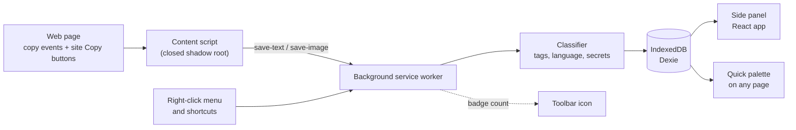

- The background service worker owns saving: it dedupes by content hash, classifies, applies the pause list and the secret guard, then writes to IndexedDB and updates the badge.
- The side panel reads the database directly and refreshes live when items change.
- A small script in the page's own context hooks `navigator.clipboard` so a site's "Copy" button is captured too, then hands the text to the content script.

```text
entrypoints/   background service worker, content script, side panel, page-context hook
components/    panel, overlay (palette, toast, region select) and shared UI (logo, mascot, icons)
lib/           types, Dexie db, classifier, settings, messaging, thumbnails, platform hints
lib/brand/     the shared moustache shape used by the logo, icons and mascot
styles/        design tokens and the Tailwind theme
scripts/       icon and brand-graphics generators
tests/e2e/     Playwright end-to-end suite
docs/          banner, screenshots, roadmap
```

## Brand

The mark is a handlebar moustache on a clipboard card: stacked bars for the "stash", a white card, and a moustache for the name. The same shape is used for the toolbar icons, the in-app logo and the mascot.

<p align="center">
  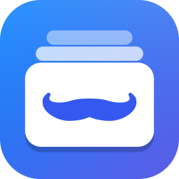
  &nbsp;&nbsp;
  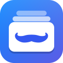
  &nbsp;&nbsp;
  
  &nbsp;&nbsp;
  
  &nbsp;&nbsp;
  
</p>

**Colour:** a blue to indigo gradient (`#0A84FF` to `#5E5CE6`) with a deeper blue ink (`#3458F0`) on a white card. **Type:** the system font (SF Pro on Apple devices, Segoe UI Variable on Windows) with JetBrains Mono for code.

The mascot is just the moustache. It has no face and shows how it feels by moving its two halves, and it holds still when Reduce motion is on:

<p align="center">
  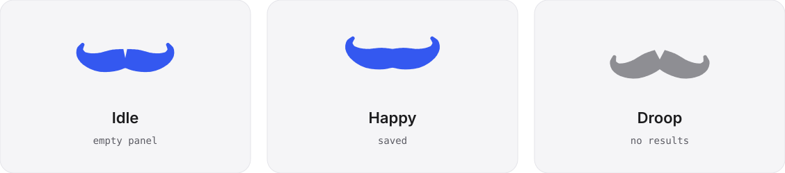
</p>

## Desktop app

> **Status: in development, pre-release.** It is not on any store and there is no public download yet. You can build the installer yourself or take it from a CI run (see below). It has only been tested on Windows 11; the macOS build is written but **untested**.

A browser extension can't see copies made in VS Code, Cursor, a terminal or an LLM desktop app. The desktop app (in [`desktop/`](desktop/README.md)) runs the same panel outside the browser and keeps one history across all of them.

<p align="center">
  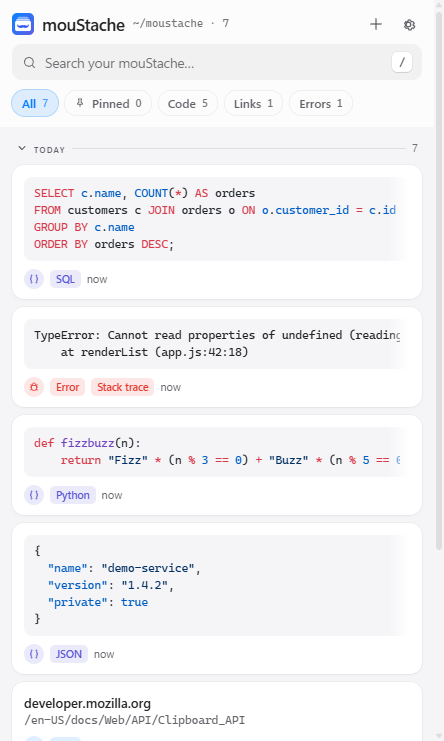
  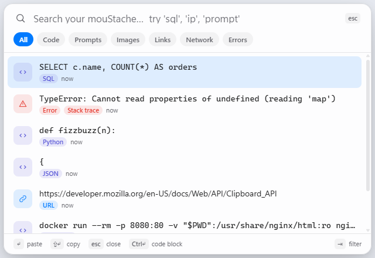
</p>

**What it adds**

- **System clipboard capture** for every app, with the same classification, tags and search. It never saves password-manager entries, secrets (API keys, tokens), text over 500 KB, its own clipboard writes, or copies made while a paused app (1Password, Bitwarden, KeePass, LastPass, Dashlane by default) is in front.
- **Tray icon** with a state that shows idle, just-captured, paused or needs-attention, a tooltip with the item count, and a menu (Open, Pause, Quick palette, Region screenshot, Settings, Launch at login, Quit). A small `Saved · SQL` pill (never the copied text) appears in a screen corner; choose Off, Tray only or Blip in Settings > Presence.
- **Quick palette on `Alt+Shift+V`** over whatever you are doing. `Enter` pastes into the app you came from, `Shift+Enter` only copies, `Ctrl+Enter` pastes as a fenced code block.
- **Region screenshot on `Alt+Shift+S`**: drag a region and it is saved as an image item. Both shortcuts can be changed in Settings > Desktop.
- **Pairing with the extension** (optional): in the app open Settings > Browser extension and copy the token; in the extension open Settings > Desktop app, turn it on and paste it. Copies made on web pages then reach the app together with the page they came from.

<p align="center">
  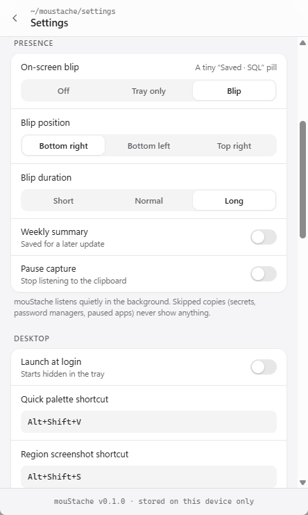
  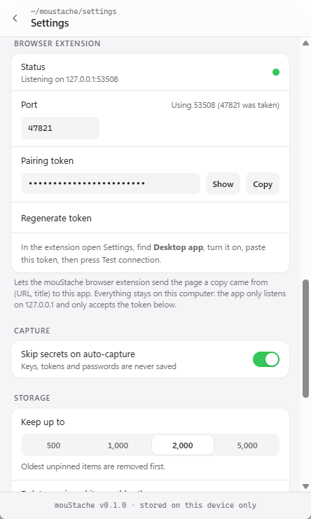
  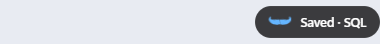
</p>

**Install from a build artifact**

- **Windows:** run `npm install` then `npm run desktop:dist:win`, or download the `mouStache-windows` artifact from a run of the *Desktop* GitHub Actions workflow. Run `mouStache-Setup-<version>.exe` (per-user install, no admin needed, you can pick the folder). The installer is **unsigned**, so Windows SmartScreen will show "Windows protected your PC": choose *More info*, then *Run anyway* only if you built or downloaded it yourself.
- **macOS:** the workflow builds `.dmg` and `.zip` for Apple Silicon and Intel, **unsigned and not notarized** unless the maintainer adds Apple credentials. Gatekeeper will refuse to open it at first (right-click, *Open*). Untested on a real Mac.
- Moving history over: in the extension use Settings > Export JSON, then in the desktop app Settings > Import JSON.

**Privacy.** Everything stays on your computer. The app makes no network requests. The only network listener is the extension bridge, bound to `127.0.0.1` (default port 47821). It answers only requests that carry your token and come from the extension. The extension sends nothing to it until you turn it on and paste the token.

**Limits you should know about**

- **macOS is untested.** The code exists (tray template icons, `osascript` paste, Accessibility permission flow, Screen Recording for screenshots) but nobody has run it on a Mac yet.
- **Windows:** paste cannot type into windows running as administrator (Windows blocks it); the item is still copied. Windows may refuse to give focus back to the previous app in rare cases.
- **Builds are unsigned**, there is no auto-update, and nothing is on a store.
- Fullscreen and Do Not Disturb are not detected (pick Tray only if the pill gets in the way). Copying the exact same text twice in a row is not seen as a new copy.
- Not yet verified by real use: pasting into Cursor, VS Code and terminals, and a real Chrome profile talking to an installed app.

Build and release details: [desktop/README.md](desktop/README.md). Plan and status: [docs/desktop-roadmap.md](docs/desktop-roadmap.md).
