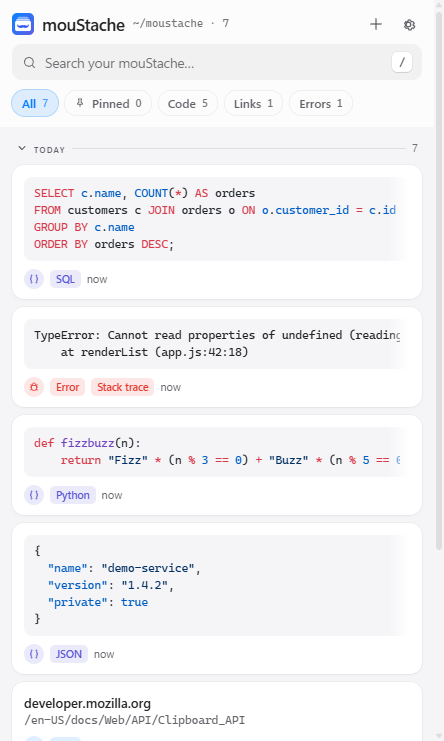

# mouStache Desktop

Electron app that runs the extension's side-panel UI (`entrypoints/sidepanel/App.tsx`) against real data, outside the browser.
It reuses `lib/` and `components/` through the `@` alias (repo root). Nothing is copied.

Run everything from the repo root (`D:\Projects\clipboard-manager`, uppercase drive letter on Windows).

| Command | What it does |
| --- | --- |
| `npm run desktop:dev` | electron-vite dev server + Electron (panel shows immediately) |
| `npm run desktop:build` | builds main, preload and renderers to `desktop/out/` |
| `npm run desktop:typecheck` | `tsc` for `desktop/` and `tests/desktop/` (also part of `npm run typecheck`) |
| `npm run desktop:e2e` | builds, then runs the Playwright-for-Electron smoke tests in `tests/desktop/` |
| `npm run desktop:pack` | build + unpacked app in `release/` (fast; current platform) |
| `npm run desktop:dist:win` | build + Windows NSIS installer in `release/` |
| `npm run desktop:dist:mac` | build + macOS dmg and zip, arm64 and x64 (run on a Mac or the workflow) |
| `npm run desktop:e2e:packaged` | smoke test of the packaged app (needs `desktop:pack` first) |
| `npm run desktop:screenshots` | regenerates `docs/screenshots/desktop-*.png` from the built app |
| `npm test` | Vitest, includes the shim and router unit tests in `desktop/src/**` |

Env: `MOUSTACHE_USER_DATA=<dir>` uses a throwaway profile; `MOUSTACHE_SHOW_PANEL=1` shows the panel on launch.

## How it fits together

- **Engine window** (hidden, never throttled): owns IndexedDB (Dexie) and answers messages with `handleMessage()` from `lib/background/router.ts`. Runs `registerCleanup()`.
- **Panel window** (460x780, hidden until shown from the tray; closing hides it): mounts the existing `App`.
- **chrome shim** (`src/renderer/chrome-shim.ts`, logic in `shim-core.ts`): installed first in every renderer, so `wxt/browser` (= `globalThis.chrome`) works unchanged. `runtime.id` is set, so the panel runs in real mode; `?demo=1` still gives demo mode.
- **Messaging**: `runtime.sendMessage` -> preload `invoke` -> main (`router.ts`) -> engine window -> `handleMessage` -> reply back. Broadcasts (`items-changed`, ...) are fanned out by main to every other window.
- **Storage**: `chrome.storage.local` is backed by localStorage, with `onChanged` fired locally and to other windows via BroadcastChannel. `storage.session` is per-window (sessionStorage).
- **Renderer origin**: production pages are served from the privileged `moustache://app` scheme (not `file:`, which the app would treat as demo mode). Dev uses the Vite server, so dev and prod data are separate.
- **Security**: contextIsolation, sandbox, no node integration, strict CSP meta tags, permission and request filtering, popups and navigation denied, IPC restricted to our own pages.

## Capture and presence (Phase 2)

mouStache polls the system clipboard (every 400 ms) in the main process and saves new text and images through the engine, so history works for every app, not just the browser. Design rules live in `docs/desktop-ambient-presence.md`.

- **Never saved**: password-manager / concealed entries, secrets (API keys, tokens), text over 500 KB, mouStache's own clipboard writes, copies while a paused app is in front (default: 1Password, Bitwarden, KeePass, LastPass, Dashlane), and anything while capture is paused. Skipped copies show no feedback.
- **Tray icon**: idle, curls briefly after a capture, dimmed when paused, a dot when something needs attention. Tooltip: `mouStache · 128 items · last: SQL, 2 min ago`. Menu: Open, Pause/Resume, Quick palette (Phase 3), Settings, Launch at login, Quit.
- **Blip**: a small `Saved · SQL` pill in a screen corner (never the copied text), click-through and never focused. Settings > Presence: Off / Tray only / Blip, position, duration. The first launch shows one pill pointing at the tray icon.
- Icons: `npm run icons` regenerates the extension icons and `desktop/resources/tray/*`.
- App-name detection: Windows via a persistent PowerShell (no native module), macOS via `lsappinfo` (untested on a Mac). If it fails the copy is captured without an app name.
- E2E hooks: `MOUSTACHE_E2E=1` exposes test-only globals in main; `MOUSTACHE_NO_FIRST_RUN=1` suppresses the first-run pill.

## Palette, paste and screenshots (Phase 3)

- **Alt+Shift+V** opens the quick palette over whatever you are doing (the same palette the extension shows on web pages). Type to search, Tab or Ctrl/Cmd+1..7 to filter. **Enter** pastes into the app you came from, **Shift+Enter** copies only, **Ctrl/Cmd+Enter** pastes as a fenced code block with the item's language, **Esc** (or clicking away) closes it. Secrets are masked in the list but still paste.
- **Alt+Shift+S** freezes the display under the mouse, you drag a region (Esc cancels), and the crop is saved as an image item (blip: `Saved · Image`).
- Both shortcuts can be changed in Settings > Desktop (press the new combination; Reset puts the default back). If the system refuses a combination the previous one keeps working and the field says why.
- Paste: Windows sends Ctrl+V through one long-lived PowerShell (`SendKeys`, fixed script, no user data in script text); it cannot type into elevated windows. macOS uses osascript and needs the Accessibility permission once (a guided prompt, then "Copied, press ⌘V" until granted). No native modules.
- Tests never press real shortcuts or send keystrokes: with `MOUSTACHE_E2E=1` paste commands are recorded instead of sent, `globalShortcut` is a stub, the screen image is synthetic, and the foreground app is pinned.

## Browser extension bridge (Phase 4)

The extension keeps working on its own. If you pair it, copies you make on web pages are also sent to this app together with the page they came from (URL without query/hash, title, favicon), so a copy seen by both the OS watcher and the extension ends up as one item that keeps the page.

- **Pair**: desktop Settings > Browser extension shows the status and a token (Show / Copy / Regenerate). In the extension: Settings > Desktop app, turn it on, paste the token, check the port, Test connection.
- **Local only**: the app listens on `127.0.0.1` (default port 47821, next ports tried if busy; Settings shows the real one). It answers only requests that carry the token, have a loopback Host and no web Origin (only `chrome-extension://`), are JSON, are small enough and pass strict validation. CORS preflight is refused. Errors are fixed codes and nothing is logged.
- **Never over the bridge**: secrets (also checked again on the desktop side), copies from paused sites, anything while capture is paused.
- **No double blip**: a duplicate of something already saved merges the page source silently.
- Regenerating the token stops the old one at once. The token is stored in `userData/bridge-token.json`.
- Tests: `desktop/src/main/bridge-core.test.ts` (unit + real server), `tests/desktop/bridge.e2e.ts` (built app, real HTTP), and one extension e2e against a stub server. `MOUSTACHE_BRIDGE_PORT=0` (with `MOUSTACHE_E2E=1`) lets the app pick a free port.

## Packaging and release (Phase 5a)

Config: `electron-builder.yml` at the repo root. The version comes from `package.json`; artifacts go to `release/` (git-ignored). Main, preload and renderers are bundled by electron-vite, so the package contains only `desktop/out/**`, `desktop/resources/**` (the tray frames, read from disk at runtime) and `package.json` inside `app.asar` (about 3 MB); no `node_modules`, tests, docs or source maps. The installer is about 116 MB because it ships Electron itself.

Icons are generated, no tools needed: `npm run icons` writes `desktop/build/icon.ico`, `icon.icns` (PNG-based, built in pure Node) and `icon.png` next to the extension icons. They are committed.

### Windows

```powershell
Set-Location D:\Projects\clipboard-manager   # uppercase drive letter
npm install
npm run desktop:dist:win      # release\mouStache-Setup-<version>.exe + release\win-unpacked\
```

NSIS, per-user install (no admin prompt), the install folder can be changed, desktop and Start menu shortcuts. Uninstalling keeps your history (`deleteAppDataOnUninstall: false`). The first build downloads the NSIS tools into the electron-builder cache. Unsigned installers trigger SmartScreen; to sign, set `CSC_LINK` (path or base64 of a .pfx) and `CSC_KEY_PASSWORD` before building.

Quick check without installing anything: `npm run desktop:pack` then `npm run desktop:e2e:packaged` launches `release/win-unpacked/mouStache.exe` with a throwaway profile and a fake clipboard and checks the panel, the `moustache://` pages, a saved item, and that the tray frames are inside `app.asar`.

### macOS (not verified on a Mac)

Build on a Mac (`npm run desktop:dist:mac`) or let the GitHub Actions workflow do it (`.github/workflows/desktop.yml`, runs on tags `desktop-v*` or manually, uploads the Windows and macOS artifacts). `.icns` is already committed (generated in Node), so no Mac-only tooling is needed for it.

Decisions in `electron-builder.yml`:

- **Tray-only app:** `LSUIElement: true`, so no Dock icon or Cmd+Tab entry. The panel and palette still open and take focus. This was chosen without a Mac to test on; delete the key if a Dock icon turns out to be better.
- **Hardened runtime on**, entitlements in `desktop/build/entitlements.mac.plist` (+ `.inherit.plist` for helper processes): `allow-jit` and `allow-unsigned-executable-memory` (Chromium's V8; Electron will not start without them) and `automation.apple-events` (paste sends Cmd+V through System Events with osascript). No App Sandbox, no camera or microphone, no `disable-library-validation` (no native modules).
- **Info.plist strings:** only `NSAppleEventsUsageDescription` (the Automation prompt text for the paste). There is no Info.plist key for Accessibility, and Screen Recording (region screenshot) uses macOS's own prompt, so nothing else is added.
- **Signing and notarization are OFF by default** (`notarize: false`), so an unsigned build works and Gatekeeper will warn on it (right-click, Open). To sign and notarize, set these before `npm run desktop:dist:mac -- -c.mac.notarize=true` (the workflow does this on its own when all of them exist as repository secrets):

| Variable | Purpose |
| --- | --- |
| `CSC_LINK`, `CSC_KEY_PASSWORD` | Developer ID Application certificate (.p12 file or base64) and its password |
| `APPLE_ID`, `APPLE_APP_SPECIFIC_PASSWORD`, `APPLE_TEAM_ID` | notarization with `notarytool` |

To force an unsigned build on a Mac that has certificates in its keychain: `CSC_IDENTITY_AUTO_DISCOVERY=false`.

### Not done

No auto-update (nothing is published; `publish: null`), no Linux target, no code signing material, and no NSIS install/uninstall or macOS run has been exercised by tests.

## Screenshots

`docs/screenshots/desktop-*.png` come from `npm run desktop:screenshots`: the built app with a throwaway profile, the fake clipboard (the real one is never read), made-up data, page captures of mouStache's own windows only (never the real screen), and the bridge token left masked.



