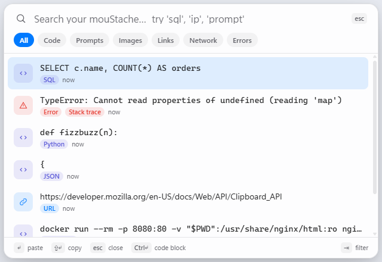

# mouStache Desktop

Electron app that runs the extension's side-panel UI (`entrypoints/sidepanel/App.tsx`) against real data, outside the browser.
It reuses `lib/` and `components/` through the `@` alias (repo root). Nothing is copied.

Run everything from the repo root (`D:\Projects\clipboard-manager`, uppercase drive letter on Windows).

| Command | What it does |
| --- | --- |
| `npm run desktop:dev` | electron-vite dev server + Electron (panel shows immediately) |
| `npm run desktop:build` | RELEASE build of main, preload and renderers to `desktop/out/` (no test seams) |
| `npm run desktop:build:test` | the same with `--mode test`: compiles in the e2e test seams. Never ship this one |
| `npm run desktop:check-release` | fails if a release bundle contains any test seam (runs before `desktop:pack` / `desktop:dist:*`) |
| `npm run desktop:check-fuses` | reads the Electron fuses of `release/win-unpacked` and fails if they are not as promised (`--test` for the test build) |
| `npm run desktop:typecheck` | `tsc` for `desktop/` and `tests/desktop/` (also part of `npm run typecheck`) |
| `npm run desktop:e2e` | builds with test seams (`desktop:build:test`), then runs the Playwright-for-Electron tests in `tests/desktop/` |
| `npm run desktop:pack` | RELEASE build + checks + unpacked app in `release/` (fast; current platform) |
| `npm run desktop:pack:test` | test-seam build + unpacked app in `release-test/` (inspect fuses on for Playwright; never ship) |
| `npm run desktop:dist:win` | build + Windows NSIS installer in `release/` |
| `npm run desktop:dist:mac` | build + macOS dmg and zip, arm64 and x64 (run on a Mac or the workflow) |
| `npm run desktop:e2e:packaged` | runs `desktop:pack:test`, then the smoke test of the packaged app |
| `npm run desktop:screenshots` | regenerates `docs/screenshots/desktop-*.png` from the built app |
| `npm test` | Vitest, includes the shim and router unit tests in `desktop/src/**` |

Env: `MOUSTACHE_USER_DATA=<dir>` uses a throwaway profile; `MOUSTACHE_SHOW_PANEL=1` shows the panel on launch.

## How it fits together

- **Engine window** (hidden, never throttled): owns IndexedDB (Dexie) and answers messages with `handleMessage()` from `lib/background/router.ts`. Runs `registerCleanup()`.
- **Panel window** (460x780, hidden until shown from the tray; closing hides it): mounts the existing `App`.
- **chrome shim** (`src/renderer/chrome-shim.ts`, logic in `shim-core.ts`): installed first in every renderer, so `wxt/browser` (= `globalThis.chrome`) works unchanged. `runtime.id` is set, so the panel runs in real mode; `?demo=1` still gives demo mode.
- **Messaging**: `runtime.sendMessage` -> preload `invoke` -> main (`router.ts`) -> engine window -> `handleMessage` -> reply back. Broadcasts (`items-changed`, ...) are fanned out by main to every other window.
- **Storage**: `chrome.storage.local` is backed by localStorage, with `onChanged` fired locally and to other windows via BroadcastChannel. `storage.session` is per-window (sessionStorage).
- **Renderer origin**: production pages are served from the privileged `moustache://app` scheme (not `file:`, which the app would treat as demo mode). Dev uses the Vite server, so dev and prod data are separate.
- **Security**: contextIsolation, sandbox, no node integration, strict CSP meta tags, permission and request filtering, popups and navigation denied, IPC restricted to our own pages.

## Capture and presence (Phase 2)

mouStache polls the system clipboard (every 400 ms) in the main process and saves new text and images through the engine, so history works for every app, not just the browser. Design rules live in `docs/desktop-ambient-presence.md`.

- **Never saved**: password-manager / concealed entries, secrets (API keys, tokens), text over 500 KB, mouStache's own clipboard writes, copies while a paused app is in front (default: 1Password, Bitwarden, KeePass, LastPass, Dashlane), and anything while capture is paused. Skipped copies show no feedback.
- **Tray icon**: idle, curls briefly after a capture, dimmed when paused, a dot when something needs attention. Tooltip: `mouStache · 128 items · last: SQL, 2 min ago`. Menu: Open, Pause/Resume, Quick palette (Phase 3), Settings, Launch at login, Quit.
- **Blip**: a small `Saved · SQL` pill in a screen corner (never the copied text), click-through and never focused. Settings > Presence: Off / Tray only / Blip, position, duration. The first launch shows one pill pointing at the tray icon.
- Icons: `npm run icons` regenerates the extension icons and `desktop/resources/tray/*`.
- App-name detection: Windows via a persistent PowerShell (no native module), macOS via `lsappinfo` (untested on a Mac). If it fails the copy is captured without an app name.
- E2E hooks: in a TEST build (`desktop:build:test`) `MOUSTACHE_E2E=1` exposes test-only globals in main; `MOUSTACHE_NO_FIRST_RUN=1` suppresses the first-run pill. None of this exists in a release build (see "Test builds vs release builds" below).

## Palette, paste and screenshots (Phase 3)

- **Alt+Shift+V** opens the quick palette over whatever you are doing (the same palette the extension shows on web pages). Type to search, Tab or Ctrl/Cmd+1..7 to filter. **Enter** pastes into the app you came from, **Shift+Enter** copies only, **Ctrl/Cmd+Enter** pastes as a fenced code block with the item's language, **Esc** (or clicking away) closes it. Secrets are masked in the list but still paste.
- **Alt+Shift+S** freezes the display under the mouse, you drag a region (Esc cancels), and the crop is saved as an image item (blip: `Saved · Image`).
- Both shortcuts can be changed in Settings > Desktop (press the new combination; Reset puts the default back). If the system refuses a combination the previous one keeps working and the field says why.
- Paste: Windows sends Ctrl+V through one long-lived PowerShell (`SendKeys`, fixed script, no user data in script text); it cannot type into elevated windows. macOS uses osascript and needs the Accessibility permission once (a guided prompt, then "Copied, press ⌘V" until granted). No native modules.
- Tests never press real shortcuts or send keystrokes: in a test build with `MOUSTACHE_E2E=1` paste commands are recorded instead of sent, `globalShortcut` is a stub, the screen image is synthetic, and the foreground app is pinned.

## Browser extension bridge (Phase 4)

The extension keeps working on its own. If you pair it, copies you make on web pages are also sent to this app together with the page they came from (URL without query/hash, title, favicon), so a copy seen by both the OS watcher and the extension ends up as one item that keeps the page.

- **Pair**: desktop Settings > Browser extension shows the status and a token (Show / Copy / Regenerate). In the extension: Settings > Desktop app, turn it on, paste the token, check the port, Test connection.
- **Local only**: the app listens on `127.0.0.1` on the configured port (default 47821). There is NO fallback to another port: if it is busy Settings shows a clear error and you pick another port here and in the extension. **The token never goes over the wire**: the extension first sends a random nonce to `/v1/hello`, the app answers with an HMAC that proves it knows the token, the extension verifies that before sending anything, and every request is then signed (HMAC over method, path, timestamp, sequence number and body hash; replays and stale timestamps are rejected). A program squatting the port cannot produce the proof, so it receives nothing but a nonce. The app also requires a loopback Host (DNS-rebinding defence), no web Origin (only `chrome-extension://`), JSON, size limits enforced while streaming, rate limits and strict validation. CORS preflight is refused. Errors are fixed codes and nothing is logged. Details: `lib/bridge-auth.ts`, `desktop/src/main/bridge-core.ts`.
- **Never over the bridge**: secrets (also checked again on the desktop side), copies from paused sites, anything while capture is paused.
- **No double blip**: a duplicate of something already saved merges the page source silently.
- Regenerating the token stops the old one at once. The token is stored in `userData/bridge-token.json`.
- Tests: `desktop/src/main/bridge-core.test.ts` (unit + real server), `bridge-client-integration.test.ts` (the extension's real client against the real server AND against a fake squatter: no capture and no token ever reach it), `tests/desktop/bridge.e2e.ts` (built app, real HTTP, busy-port error), and one extension e2e against a stub server plus a squatter. In a test build `MOUSTACHE_BRIDGE_PORT=0` (with `MOUSTACHE_E2E=1`) lets the app pick a free port.

## Packaging and release (Phase 5a)

Config: `electron-builder.yml` at the repo root. The version comes from `package.json`; artifacts go to `release/` (git-ignored). Main, preload and renderers are bundled by electron-vite, so the package contains only `desktop/out/**`, `desktop/resources/**` (the tray frames, read from disk at runtime) and `package.json` inside `app.asar` (about 3 MB); no `node_modules`, tests, docs or source maps. The installer is about 116 MB because it ships Electron itself.

Icons are generated, no tools needed: `npm run icons` writes `desktop/build/icon.ico`, `icon.icns` (PNG-based, built in pure Node) and `icon.png` next to the extension icons. They are committed.

### Windows

```powershell
Set-Location D:\Projects\clipboard-manager   # uppercase drive letter
npm install
npm run desktop:dist:win      # release\mouStache-Setup-<version>.exe + release\win-unpacked\
```

NSIS, per-user install (no admin prompt), the install folder can be changed, desktop and Start menu shortcuts. Uninstalling keeps your history (`deleteAppDataOnUninstall: false`). The first build downloads the NSIS tools into the electron-builder cache. Unsigned installers trigger SmartScreen; to sign, set `CSC_LINK` (path or base64 of a .pfx) and `CSC_KEY_PASSWORD` before building.

Quick check without installing anything: `npm run desktop:e2e:packaged` builds the test-seam package and launches `release-test/win-unpacked/mouStache.exe` with a throwaway profile and a fake clipboard and checks the panel, the `moustache://` pages, a saved item, and that the tray frames are inside `app.asar`.

### macOS (not verified on a Mac)

Build on a Mac (`npm run desktop:dist:mac`) or let the GitHub Actions workflow do it (`.github/workflows/desktop.yml`, runs on tags `desktop-v*` or manually, uploads the Windows and macOS artifacts). `.icns` is already committed (generated in Node), so no Mac-only tooling is needed for it.

Decisions in `electron-builder.yml`:

- **Tray-only app:** `LSUIElement: true`, so no Dock icon or Cmd+Tab entry. The panel and palette still open and take focus. This was chosen without a Mac to test on; delete the key if a Dock icon turns out to be better.
- **Hardened runtime on**, entitlements in `desktop/build/entitlements.mac.plist` (+ `.inherit.plist` for helper processes): `allow-jit` and `allow-unsigned-executable-memory` (Chromium's V8; Electron will not start without them) and `automation.apple-events` (paste sends Cmd+V through System Events with osascript). No App Sandbox, no camera or microphone, no `disable-library-validation` (no native modules).
- **Info.plist strings:** only `NSAppleEventsUsageDescription` (the Automation prompt text for the paste). There is no Info.plist key for Accessibility, and Screen Recording (region screenshot) uses macOS's own prompt, so nothing else is added.
- **Signing and notarization are OFF by default** (`notarize: false`), so an unsigned build works and Gatekeeper will warn on it (right-click, Open). To sign and notarize, set these before `npm run desktop:dist:mac -- -c.mac.notarize=true` (the workflow does this on its own when all of them exist as repository secrets):

| Variable | Purpose |
| --- | --- |
| `CSC_LINK`, `CSC_KEY_PASSWORD` | Developer ID Application certificate (.p12 file or base64) and its password |
| `APPLE_ID`, `APPLE_APP_SPECIFIC_PASSWORD`, `APPLE_TEAM_ID` | notarization with `notarytool` |

To force an unsigned build on a Mac that has certificates in its keychain: `CSC_IDENTITY_AUTO_DISCOVERY=false`.

### Not done

No auto-update (nothing is published; `publish: null`), no Linux target, no code signing material, and no NSIS install/uninstall or macOS run has been exercised by tests.

## Screenshots

`docs/screenshots/desktop-*.png` come from `npm run desktop:screenshots`: the built app with a throwaway profile, the fake clipboard (the real one is never read), made-up data, page captures of mouStache's own windows only (never the real screen), and the bridge token left masked.




### Test builds vs release builds

The e2e suites need seams (an in-memory clipboard, recorded instead of sent paste commands, stub global shortcuts, a synthetic screen image, a pinned foreground app, `__mou*` inspection hooks). They live in `desktop/src/main/testing.ts` and are reached only through the compile-time constant `__MOU_TEST_BUILD__`, which `electron.vite.config.ts` sets to `true` ONLY for `--mode test` (`desktop:build:test`, used by `desktop:e2e`, `desktop:pack:test`, `desktop:e2e:packaged`, `desktop:screenshots`). Every other build (`desktop:build`, `desktop:dev`, `desktop:pack`, `desktop:dist:*`) gets the literal `false`, so the bundler removes all of it. `npm run desktop:check-release` greps `desktop/out` for the hook and switch names and fails the release scripts if one is found; a unit test keeps that marker list in step with `testing.ts`. Even in a test build, nothing activates unless `MOUSTACHE_E2E=1` is set.

## Security model and known limits

mouStache Desktop is a local app: everything stays on this computer and the only listening socket is the optional extension bridge on `127.0.0.1`. An independent security review was done after Phase 5a; this section records what was fixed and what is **accepted or known**.

### Fixed in the review (each has a test)

| # | Finding | Fix |
| --- | --- | --- |
| F1 | A program squatting the bridge port received the bearer token and every capture; the extension never authenticated the server | Port fallback removed (a busy port is a visible error). The token never goes over the wire: client sends a nonce, the server proves it knows the token (HMAC), the client verifies that BEFORE sending any content, then every request is signed (HMAC over method, path, timestamp, sequence, body hash) with a per-session key; replays and stale timestamps are rejected; a regenerated token ends all sessions at once. See `lib/bridge-auth.ts`. |
| F2 | `ELECTRON_RENDERER_URL` honoured in packaged builds; test hooks reachable | Packaged apps ignore it. Test seams (`__mou*` hooks, fake clipboard, recorded paste, stub shortcuts, env switches) are compiled in only for test builds (`--mode test`, constant `__MOU_TEST_BUILD__`) and are dead-code-eliminated from release builds; `npm run desktop:check-release` (run by `desktop:pack` and `desktop:dist:*`) fails if any marker is in `desktop/out`. `MOUSTACHE_USER_DATA`, `MOUSTACHE_SHOW_PANEL` and `MOUSTACHE_NO_FIRST_RUN` are honoured only in unpackaged runs and test builds. |
| F3 | Secrets were only searched in the first 20,000 characters | The whole text (up to 1 MB) is scanned; every pattern uses bounded repetition (adversarial 1 MB strings tested). |
| F4 | Import trusted the file's hash, tags, language and secret flag | Hash is recomputed from the content; tags, language and secret are recomputed with the classifier (a file can only mark more things secret, never fewer); user-owned fields (pinned, createdAt, source) are kept. |
| F6 | Forwarder could send over-long or non-http `source` and back off for 30 s on one refused capture | `source` is fitted to the bridge limits before sending; only outages (not a refused capture) back off. |
| F7 | IPC trusted any of our own pages | Channels are bound to window roles (`ipc-policy.ts`): the blip pill can call nothing, the screenshot overlay only its own two channels, the palette only search/copy-item plus its own channels, the engine only its plumbing, the panel the rest. |
| F8 | `shell.openExternal` from any page | Panel only, http/https only, at most 2048 characters, at most one per 2 s. |
| F11 | SVG could be stored as an "image" | Raster formats only (png, jpeg, webp, gif) on save and on import. The side panel's "open image in a new tab" is kept; it opens a `blob:` URL of a raster image. |
| F12 | Missing "do not record" signals | `Clipboard Viewer Ignore`, `CanUploadToCloudClipboard` = 0 and `org.nspasteboard.AutoGeneratedType` are treated like the other concealed formats. |
| F13 | A secret written by mouStache sat on the clipboard (and in history / cloud clipboard) | Secrets are written with the exclusion formats and wiped after about 30 s if still there (palette and panel copy). |
| F14 | Electron fuses | Release: RunAsNode, NODE_OPTIONS and `--inspect` OFF; ASAR integrity and only-load-from-asar ON (read back with `npm run desktop:check-fuses`). The packaged TEST build (`electron-builder.test.yml`, `desktop:pack:test`) keeps the two inspect fuses ON because Playwright needs them; it contains the test seams and must never be shipped. |
| F15 | `powershell.exe` resolved through PATH | Absolute `%SystemRoot%\System32\WindowsPowerShell\v1.0\powershell.exe`, bare name only if that file is missing. |
| F16 | macOS app names could be read as osascript options | Names starting with `-` are refused. |
| F17 | The foreground sampler could outlive the app | It exits when its parent process is gone or its output pipe breaks. |
| F18 | Decompression bombs through the clipboard | PNG/JPEG/GIF/WebP headers are read first; more than 16384 px per side or 64 megapixels is refused before decoding. |
| F19b | Menu and DevTools in releases | No application menu (macOS keeps Edit only) and no DevTools in packaged builds. |
| F19d | Token file | Written atomically (temp file + rename), mode 0600 best effort. The mode is a no-op on Windows, where the user-profile ACL is the protection. |
| naming | App name was "stash" | The app is named mouStache (`app.setName`), so the data folder is `%APPDATA%\mouStache`. The Dexie database is still called `stash`. The app is unreleased, so no migration. |

### Accepted / known (not changed)

- **F5, page JavaScript can spoof copy events.** The extension's MAIN-world hook reports programmatic clipboard writes; a hostile page can therefore put text into the history. It is rate limited (10 per 10 s per page) and requires a user gesture; the history is page-influenced by design.
- **F9, bridge settings live next to the other settings.** Moving the token to a separate storage key would not help: every extension context, content scripts included, can read all of `chrome.storage.local`. The real fix (`setAccessLevel('TRUSTED_CONTEXTS')` plus message passing for settings) would break the content script's theming and is invasive, so it is skipped. A compromised content script can therefore read the pairing token. Impact is limited: it still needs to run code inside this machine's own extension to talk to the loopback bridge.
- **F10, a compromised content script can query the history** through the extension's messaging (that is how the overlay palette works).
- **F19a, any `chrome-extension://` origin is accepted by the bridge.** This does not matter: the token (HMAC handshake) is what authenticates, and a different extension does not have it.
- **Relay by a port squatter.** A program that squats the port AND can reach the real app on another port could relay the handshake and then read the signed requests that follow. Bodies are not encrypted. It would have to know the real port; there is no silent fallback to make that easy.
- **F19c, windows can appear in screen sharing.** The panel, palette, blip and screenshot overlay are ordinary windows; use "Tray only" or "Off" for the blip while streaming.
- **F19d/e, plaintext at rest, and the palette search reveals secret substrings.** The history (IndexedDB) and `bridge-token.json` are stored unencrypted in your profile folder. Secrets are masked in lists but a search query that matches part of a secret will still find the item.
- **F19g, the per-user install directory is writable by the user.** Anything running as you can replace the app. There is no auto-update, and builds are unsigned (SmartScreen / Gatekeeper warnings).
- **Copying identical text twice in a row** is not seen as a new copy (no native clipboard sequence number).
- **macOS is unverified**: foreground detection, osascript paste, Accessibility and Screen Recording flows, template icons, concealed pasteboard types, fuses on macOS.
- **Not verified end to end:** real Chrome profile with the installed extension talking to an installed app; real paste into Cursor / VS Code; elevated windows cannot be pasted into.
